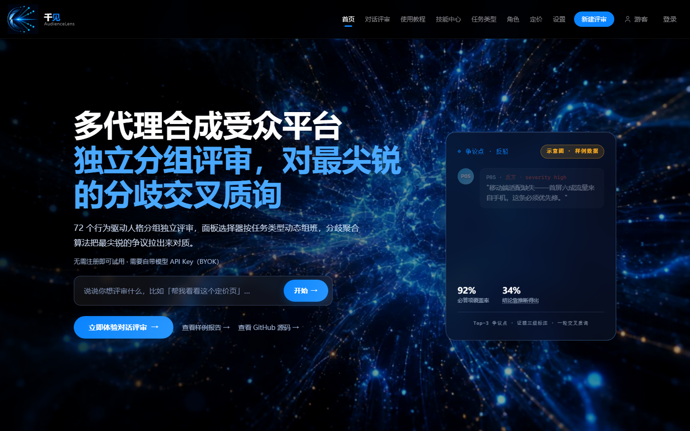
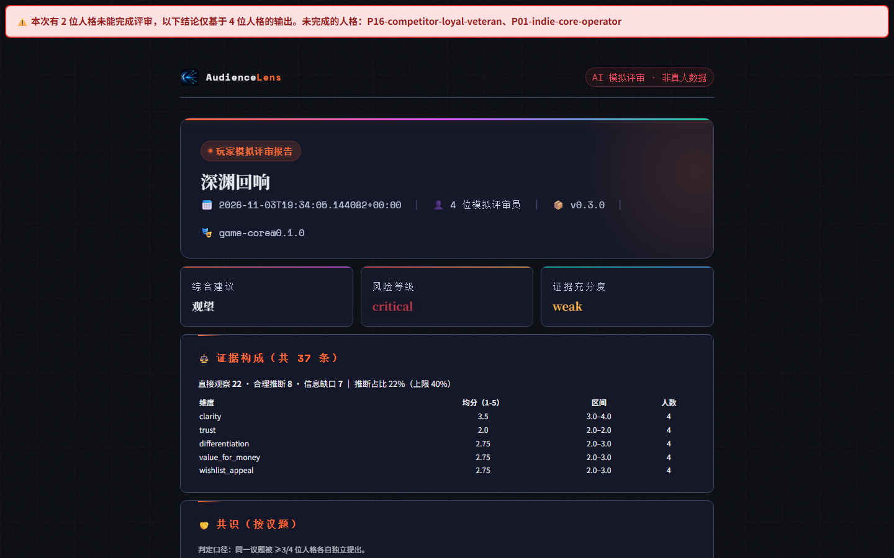
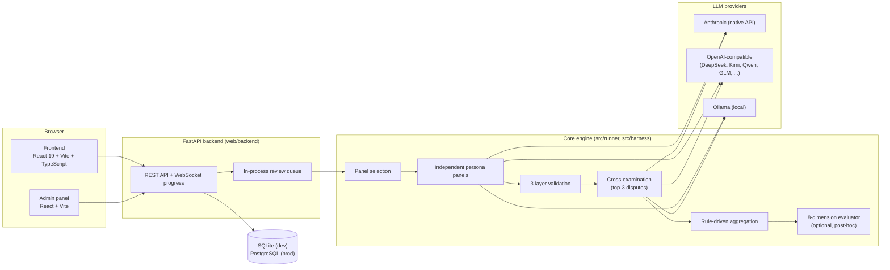

<div align="center">

# AudienceLens

**A panel of independent AI personas reviews your product, then argues out its sharpest disagreements — with every claim tagged by evidence.**

[](https://github.com/jedi-ling/audiencelens/actions/workflows/ci.yml)
[](LICENSE)
[](pyproject.toml)
[](web/frontend/package.json)

English · [中文](README_zh.md)

</div>

- **What it is** — a multi-agent *synthetic audience review* system: a Python engine, a FastAPI + React web app, a CLI and an MCP server. You give it a Steam page, a pricing page, a pitch deck or a game concept; it returns a structured report of risks, disagreements and fixes.
- **Who it's for** — indie developers and small product teams who want a cheap, fast pre-screen *before* spending money on real user research.
- **What's different** — personas review in isolation (no herding), only the top-3 genuine disagreements are cross-examined, vote changes are decided by code rather than by an LLM judge, and every piece of evidence is tagged `direct` / `inferred` / `gap` with a hard 40% cap on inference.

> **AudienceLens is not a substitute for real user research.** Its output is synthetic. There is no validated accuracy data yet — see [Validation status](#validation-status).

---

## Screenshots




---

## Sample reports

Real engine runs on fictional product material, saved exactly as generated — no manual edits
(`examples/reports/`; also browsable on the app's `/samples` page). Standard depth, model
`claude-sonnet-5-5`, generated 2026-11-04; cost is the app's own accounting.

| Report | Input | Cost | Outcome |
|---|---|---|---|
| [Steam store page — 深渊回响](examples/reports/steam-page-abyss-echo/report.md) | `test-materials/03_steam商店页_深渊回响.md` (`steam_page_review`, `game-core`) | $0.34 | 4 of 6 personas passed validation; no cross-examination (no qualifying dispute) |
| [SaaS pricing page — 云笔记订阅](examples/reports/saas-pricing-cloud-notes/report.md) | `test-materials/04_定价页_云笔记订阅.md` (`pricing_page_review`, `general-consumer`) | $0.23 | 5 of 5 personas passed; no cross-examination (no qualifying dispute) |
| [Startup pitch — 轻账 LiteBooks](examples/reports/startup-pitch-cloud-accounting/report.md) | `test-materials/02_创业BP_云会计SaaS.pdf` (`pitch_review`, `startup-panel`) | $0.35 | 3 of 6 personas passed validation; no cross-examination |

Why some personas fail and why cross-examination did not trigger is written up in
[docs/evaluation/runs/2026-11-04-sonnet55-before-fix/notes.md](docs/evaluation/runs/2026-11-04-sonnet55-before-fix/notes.md)
and the [Known limitations](#known-limitations) below.

---

## Architecture



The same engine runs behind the CLI (`audiencelens`), the Python API (`runner.cli.run_panel`), the MCP server (`audiencelens-mcp`) and the web app. Deeper write-ups: [docs/ARCHITECTURE.md](docs/ARCHITECTURE.md) and the methodology paper [docs/paper/arxiv-paper.md](docs/paper/arxiv-paper.md).

**By the numbers** (each one is recomputed from the repo by `tests/test_public_claims.py`, which fails if this file drifts):
72 behavior-driven personas across 11 packs, 14 task types; the backend has 121 route handlers, 28 service modules and 7 emitted WebSocket event types; the frontend has 25 page components and 16 components.

---

## How a review runs

1. **Panel selection** — `src/runner/panel_selector.py` picks personas for the task type and always includes a designated dissenter. Panel size depends on the mode (`quick` / `standard` / `full`).
2. **Independent persona panels** — each persona reviews the material on its own, in parallel (`run_panel` in `src/runner/cli.py`). No persona sees another persona's output or identity before step 4.
3. **Validation** — `src/runner/validator.py` checks every output: JSON schema → role consistency → evidence grounding. An output that fails can be retried (`src/config/budget.yaml`); if it still fails it is **excluded** from the report and listed in `failed_personas`.
4. **Disagreement extraction** — `extract_controversy_points` in `src/runner/cross_exam.py` merges near-identical issues across personas (semantic similarity via `src/runner/similarity.py`, falling back to string similarity), then ranks them by the **variance of severity** between personas and keeps the top 3. Points everyone already agrees on are never debated.
5. **Cross-examination, one rebuttal round per dispute** — the two most opposed personas on each point get the other side's argument back, labelled only `A1` / `B1`. In `standard` mode one moderated call writes both rebuttals; in `full` mode each persona is re-invoked separately; `quick` skips this step.
6. **Vote change decided by code** — `_decide_change` in `src/runner/cross_exam.py` records a stance change only if the stance text actually changed **and** `|Δconfidence| ≥ θ`, where θ is `confidence_change_threshold: 0.15` in `src/config/aggregation-rules.yaml`. The model saying "I changed my mind" counts for nothing; rejected changes are kept as `suppressed_changes`.
7. **Evidence levels** — every claim carries `direct` (quoted from the material), `inferred`, or `gap` (information that is missing). `MAX_INFERRED_RATIO = 0.4` in `src/runner/validator.py` caps inference at 40% per persona.
8. **Aggregation** — `src/runner/aggregator.py` turns the validated outputs into consensus, disagreements, prioritised fixes and a release-risk level, in JSON, Markdown and HTML.

Only one rebuttal round is implemented. Multi-round debate, early termination and consensus tracking are designed but **not** implemented (see the paper, §3).

---

## Key design decisions

### 1. Independent panels before any cross-talk
**Decision.** Personas never see each other during the first pass; the prompt is split into a byte-identical shared part (task, materials, rules) and a per-persona part (`render_prompt_split` in `src/runner/persona_agent.py`), run in parallel by `run_panel` (`src/runner/cli.py`).
**Why.** Anchoring and herding are the classic focus-group failure; a single LLM asked to "play six users" converges on one voice.
**Trade-off.** No emergent consensus, and cost grows linearly with panel size. The shared prefix is sent as a cacheable system block to soften that.

### 2. Vote changes decided by code, not by an LLM judge
**Decision.** After the rebuttal, the model only reports a new stance and confidence; whether that is a "change" is computed in `_decide_change` (`src/runner/cross_exam.py`) against θ from `src/config/aggregation-rules.yaml`.
**Why.** An LLM judge is another unaudited opinion, and models happily claim to have been persuaded. A deterministic rule is reproducible and inspectable.
**Trade-off.** θ = 0.15 is an engineering guess, not a calibrated value; subtle but real changes below θ are dropped (and kept visibly as `suppressed_changes`). `audiencelens cross-exam-ablation` (`src/harness/cross_exam_ablation.py`) exists to measure this; no result is published yet.

### 3. Evidence-level tagging with a hard inference cap
**Decision.** Every claim is tagged `direct` / `inferred` / `gap`; outputs whose inferred share exceeds `MAX_INFERRED_RATIO` (`src/runner/validator.py`) fail validation and are excluded.
**Why.** The cheapest failure of synthetic research is plausible-sounding feedback grounded in nothing. Making the evidence type explicit lets a reader discount it, and `gap` turns "I don't know" into a useful output.
**Trade-off.** The tags are self-reported by the model; only `direct` evidence is checked against the source text (evidence grounding in the same file). The 40% cap can also reject outputs that were reasonable.

---

## Privacy & ethics

- **Per-visitor guest isolation.** Every unauthenticated visitor gets their own guest identity, carried by a signed, HttpOnly, SameSite=Lax cookie (Secure in production) — see `resolve_guest_identity` in `web/backend/app/deps.py`. Conversations, reviews, projects, usage and CDK balance are scoped to it; the claim-after-login flow moves only that guest's records. 22 isolation tests live in `web/backend/tests/test_guest_isolation.py`. Legacy rows from before this fix can be quarantined with `web/backend/scripts/quarantine_anonymous.py` (dry-run by default, deletes nothing).
- **Demographic fields stripped before prompting.** Only the whitelisted `CORE_FIELDS` of a persona (behavior profile, decision rules, triggers, …) are serialised into the prompt (`_minify_persona` in `src/runner/persona_agent.py`); audience fields such as age band or region never reach the model. `check_identity_behavior_decoupling` in `src/runner/validator.py` flags identity-based reasoning in the output, and a 50-case labelled stereotype benchmark ships with the harness.
- **BYOK keys encrypted at rest.** Stored API keys are encrypted with Fernet (`cryptography`) using a key derived from `AL_ENCRYPTION_KEY`, which is separate from the session-signing secret (`web/backend/app/core/security.py`). The UI only ever shows masked keys.
- **Labelled as synthetic.** Reports carry a mandatory "AI-generated synthetic review, not real user research" notice; see [ETHICS.md](ETHICS.md).

---

## Tech stack

| Layer | Technology |
|---|---|
| Engine | Python 3.11, Jinja2 prompt templates, jsonschema, PyYAML, Click CLI |
| LLM access | Anthropic SDK (native `/v1/messages`) + an OpenAI-compatible HTTP client (`src/runner/llm_client.py`) |
| Backend | FastAPI, SQLAlchemy, WebSocket progress, in-process job queue |
| Database | SQLite (development), PostgreSQL 16 (production; CI runs the backend suite on both) |
| Frontend | React 19, TypeScript, Vite, Tailwind CSS 4, Zustand, Recharts, three.js |
| Admin | React + Vite, Vitest |
| Deployment | Docker Compose + Caddy (automatic HTTPS), or bare-metal systemd + nginx ([web/DEPLOY.md](web/DEPLOY.md)) |
| CI | GitHub Actions ([.github/workflows/ci.yml](.github/workflows/ci.yml)) |

---

## Quickstart

### CLI (Anthropic key)

```bash
pip install -e .                      # registers the `audiencelens` command
export ANTHROPIC_API_KEY=...          # your own key
audiencelens run synthetic-playtest steam_page_review examples/steam-page-sample/artifact.json
```

Without `ANTHROPIC_API_KEY` the CLI runs in **simulation mode**: every persona output is placeholder data with zero review value, and the report says so prominently.

### Web app (local, bring your own key)

```bash
# backend → http://127.0.0.1:8001
cd web/backend
pip install -r requirements.txt
python run.py

# frontend (second terminal) → open the URL Vite prints
cd web/frontend
npm install
npm run dev
```

With the default `AL_AUTH_ENABLED=false` the app runs in single-user mode. Open **Settings → API keys** and add either an Anthropic key or any **OpenAI-compatible** provider (DeepSeek, Kimi, Qwen, GLM, … — presets are in `OPENAI_COMPATIBLE_PRESETS` in `src/runner/llm_client.py`). Configuration reference: [.env.example](.env.example) (names only) and [docs/MAINTENANCE.md](docs/MAINTENANCE.md).

### Ollama (local models)

Pick the **Ollama** preset (`http://localhost:11434/v1`) as an OpenAI-compatible provider and enter the model you have pulled. From Python, pass `provider="openai_compatible"`, `api_base=...` and `model_override=...` to `run_panel`.

> **SSRF guard.** The backend refuses loopback and private-network `api_base` addresses (`assert_api_base_is_safe` in `web/backend/app/api/platform.py`) unless it runs in single-user mode (`AL_AUTH_ENABLED=false`) on a non-production host. A local Ollama therefore works for local use only, never on a multi-tenant deployment. Review quality depends heavily on the model; small local models often fail the structured-output validation.

### Docker

```bash
cd web
cp .env.production.example .env      # then set AL_CORS_ORIGINS and AL_JWT_SECRET at minimum
docker compose up
```

---

## Tests

```bash
python -m pytest tests/ -q                          # core engine
(cd web/backend && python -m pytest tests/ -q)      # backend (SQLite; CI also runs it on PostgreSQL)
(cd web/frontend && npm run build)                  # i18n check + TypeScript + Vite build
(cd web/admin && npx vitest run)                    # admin panel unit tests
```

Measured 2026-11-04: core 1853 passed / 9 skipped · backend 944 passed / 1 skipped · admin vitest 35 passed.

CI ([ci.yml](.github/workflows/ci.yml)) runs all of the above on every push and pull request, plus a PostgreSQL 16 backend job, a skill-mirror consistency check and a YAML parse check.

---

## Validation status

**No validated accuracy data yet.** Nothing in this repository shows that AudienceLens predicts what real users will say, or that cross-examination improves a review. The methodology for finding out is written down but not yet executed:

- [docs/benchmark-protocol.md](docs/benchmark-protocol.md) — blind comparison against a single-prompt baseline and a quick human review
- [docs/pilot-playbook.md](docs/pilot-playbook.md) — Steam store-page pilot with real projects
- [docs/product-validation.md](docs/product-validation.md) — decision-value metrics (usefulness, decision change, adoption)
- [docs/parity-data-collection-plan.md](docs/parity-data-collection-plan.md) — collecting paired real-user reference data

An early demo example ("Cyber Scavenger") was **retracted** because its numbers could not be reproduced from the system as built; the paper explains why in [§4.5 On the Absence of a Case Study](docs/paper/arxiv-paper.md#45-on-the-absence-of-a-case-study).

<!-- TODO(evaluation): add an "Evaluation results" section once the benchmark protocol has been run on real projects. Do not add numbers before then. -->

---

## Known limitations

- **Synthetic ≠ real users.** Personas are prompts over a language model; they can be confidently wrong in ways real users never would be.
- **LLM bias.** Outputs inherit the underlying model's biases. Stereotype checks reduce but do not remove this, and different providers give materially different reviews.
- **Cost scales with panel size.** Each persona is a separate model call, and `full` mode adds one rebuttal call per involved persona.
- **No platform key is offered.** Hosted use is bring-your-own-key only; the plan / quota / CDK machinery exists in code but is not funded.
- **Cross-examination often does not trigger without the optional semantic model.** Without `sentence-transformers`, `src/runner/similarity.py` falls back to string similarity, so differently worded versions of the same issue are not merged and no point qualifies as a dispute — none of the three sample reports ran it.
- **Some persona outputs fail validation.** The validator rejects paraphrases labelled `direct` and malformed submissions; one repair turn recovers many of them, not all (see the sample outcomes above).
- **Single debate round.** Further rounds, early termination and consensus tracking are designed but not implemented; θ is uncalibrated.

---

## Development note

AudienceLens was built by Ling Yuanyi with AI-assisted development (Claude Code). Design, code review and verification — including the test suites, the claim checks in `tests/test_public_claims.py` and the retraction of unreproducible results — are the author's.

## License

[MIT](LICENSE) © 2026 Ling Yuanyi

## Author

**Ling Yuanyi** — GitHub [@jedi-ling](https://github.com/jedi-ling)
