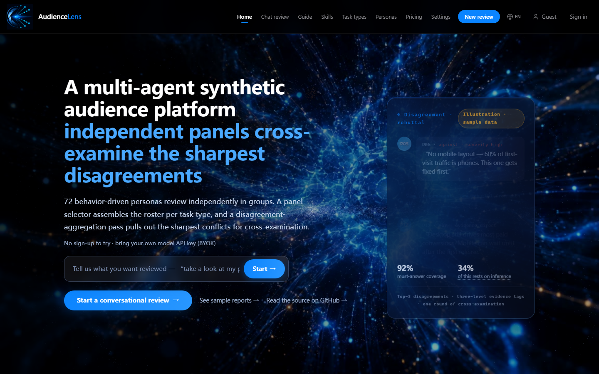
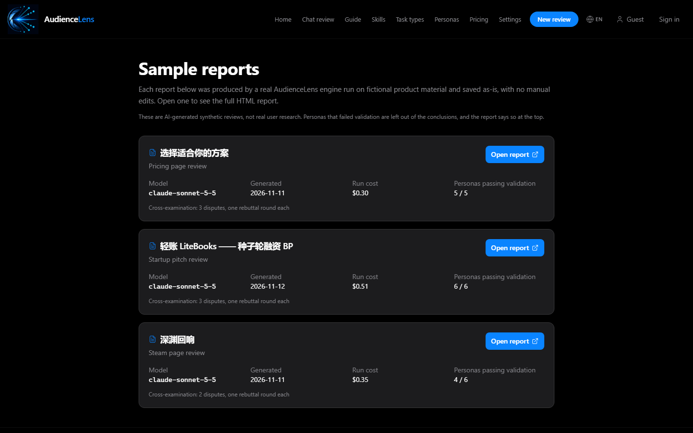
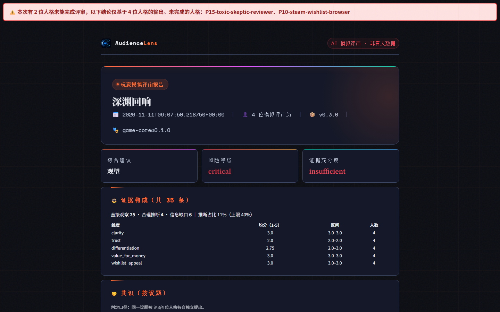
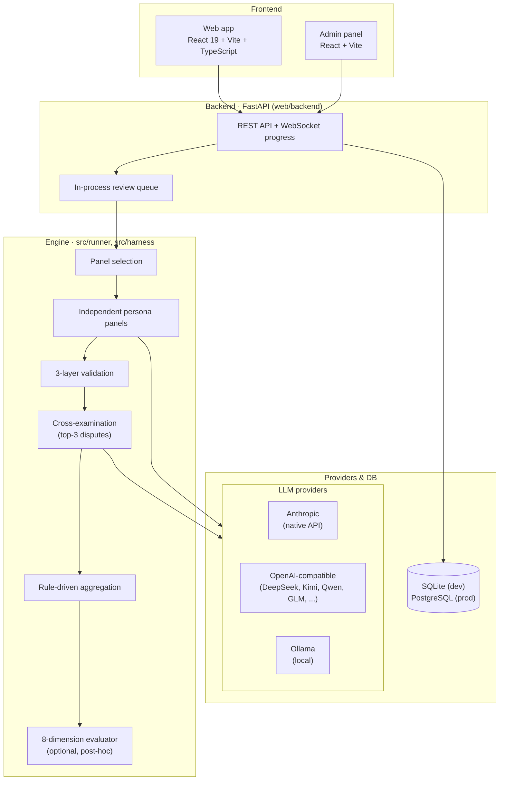

<div align="center">

# AudienceLens

**互いに独立した AI ペルソナのパネルがプロダクトをレビューし、意見が最も割れた論点だけを反論させます。すべての主張にはエビデンスのレベルが付きます。**

[](https://github.com/jedi-ling/audiencelens/actions/workflows/ci.yml)
[](LICENSE)

[English](README.md) · [中文](README_zh.md) · 日本語

</div>

- **概要**：マルチエージェントによる「合成オーディエンス・レビュー」システムです。Python エンジン、FastAPI + React の Web アプリ、CLI、MCP サーバーで構成されています。Steam ストアページ、料金ページ、ピッチ資料、ゲームのコンセプトを入力すると、リスク・意見の対立・改善案を構造化したレポートを返します。
- **対象**：実際のユーザーリサーチに費用をかける前に、安く素早く一次スクリーニングをしたいインディー開発者や小規模なプロダクトチーム。
- **特徴**：ペルソナは互いの出力を見ずにレビューします（同調を防ぐため）。反論させるのは本当に意見が割れた上位 3 論点だけです。票の変更は LLM ではなくコードが判定し、すべてのエビデンスに `direct` / `inferred` / `gap` のタグが付きます（推論は 40% が上限）。

> **AudienceLens は実際のユーザーリサーチの代わりにはなりません。** 出力はすべて合成データです。検証済みの精度データはまだありません（[検証状況](#検証状況)を参照）。

---

## スクリーンショット





<sub>UI は英語版のスクリーンショットです（日本語 UI は未対応）。レポート本文は中国語です。現在のエンジンは中国語のレポートのみを生成します。</sub>

---

## サンプルレポート

架空のプロダクト資料に対して実際のエンジンを動かした結果を、生成されたまま保存しています（手作業での編集はありません）。標準モード、モデルは `claude-sonnet-5-5`、2026-11-11 と 2026-11-12 に実行、セマンティック重複排除は有効、コストはアプリ自身の集計値です。各フォルダの `meta.json` に実行の記録、`persona_outputs.json` に検証を通過したペルソナ出力があります。

| レポート | 入力 | 検証を通過したペルソナ | 資料に基づく `direct` エントリ | 反論ステップ | コスト |
|---|---|---|---|---|---|
| [Steam ストアページ — 深渊回响](examples/reports/steam-page-abyss-echo/report.md) | `test-materials/03_steam商店页_深渊回响.md` | 6 人中 4 人 | 25 件中 25 件 | 争点 2 件、各 1 ラウンドの反論 | $0.35 |
| [SaaS 料金ページ — 云笔记订阅](examples/reports/saas-pricing-cloud-notes/report.md) | `test-materials/04_定价页_云笔记订阅.md` | 5 人中 5 人 | 36 件中 36 件 | 争点 3 件、各 1 ラウンドの反論 | $0.30 |
| [スタートアップのピッチ — 轻账 LiteBooks](examples/reports/startup-pitch-cloud-accounting/report.md) | `test-materials/02_创业BP_云会计SaaS.pdf` | 6 人中 6 人 | 42 件中 42 件 | 争点 3 件、各 1 ラウンドの反論 | $0.51 |

Steam のサンプルはコミット `af4e8c8` で生成し、ほかの 2 件は「タスク種別からペルソナパックを決める」修正（`939e8ca`）のあとに生成しました。ピッチのサンプルでは、反論ステップを同じ検証済み出力に対する 2 段階目として実行しています（`runner.cli.run_panel_from_outputs`）。

「資料に基づく」とは、エントリの `quote` が資料の文言であるという意味です。横に書かれたコメントは照合していません。Steam のサンプルで不合格になった 2 人は、照合ではなくツール入力の形式が壊れていたことが原因です。1 つのモデルでの 3 回の実行は合格率ではありません。最初のサンプル（2026-11-04、エビデンスに `quote` フィールドがなかった時期）は [docs/evaluation/runs/2026-11-04-pre-quote-field/](docs/evaluation/runs/2026-11-04-pre-quote-field/notes.md) に証拠として残しており、前後の比較は [docs/evaluation/grounding-check.md](docs/evaluation/grounding-check.md) にあります。

どの反論でも票は変わりませんでした。信頼度の変化は最大 8 ポイントで、しきい値の 15 ポイントには届いていません。理由の仮説と検証方法は [docs/evaluation/](docs/evaluation/) にまとめています。サンプルの入力資料とレポートは中国語です。

---

## アーキテクチャ



CLI（`audiencelens`）、Python API（`runner.cli.run_panel`）、MCP サーバー（`audiencelens-mcp`）、Web アプリはすべて同じエンジンを使います。詳細は [docs/ARCHITECTURE.md](docs/ARCHITECTURE.md) と手法論文 [docs/paper/arxiv-paper.md](docs/paper/arxiv-paper.md)（英語）を参照してください。

---

## レビューの流れ

1. **パネル選定**：タスクの種類に合わせてペルソナを選びます。反対役のペルソナが必ず 1 人入ります（`src/runner/panel_selector.py`）。
2. **独立したレビュー**：各ペルソナが並列に、ほかのペルソナの出力や身元を見ずに資料をレビューします。
3. **検証**：JSON スキーマ → 役割の一貫性 → エビデンスの裏付け、の 3 層でチェックします（`src/runner/validator.py`）。リトライ後も不合格の出力はレポートから**除外**され、`failed_personas` に記録されます。
4. **争点の抽出**：言い回しが違うだけの同じ指摘をセマンティック類似度でまとめ、ペルソナ間の深刻度の分散が大きい順に上位 3 件を残します。全員が同意している点は議論しません。
5. **反論（1 ラウンド）**：対立する 2 つの意見を匿名（`A1` / `B1`）で突き合わせます。`standard` モードでは 1 回の呼び出しで両側の反論を書き、`full` モードではペルソナごとに呼び出します。
6. **票の変更はコードが判定**：立場の文言が実際に変わり、**かつ** `|Δ信頼度| ≥ θ`（`src/config/aggregation-rules.yaml` の `confidence_change_threshold: 0.15`）の場合だけ変更として記録します（`src/runner/cross_exam.py` の `_decide_change`）。
7. **エビデンスレベル**：すべての主張に `direct`（資料からの引用）/ `inferred`（推論）/ `gap`（欠けている情報）が付き、推論はペルソナごとに 40% までです。
8. **集約**：合意点・対立点・優先度付きの改善案・リリースリスクを JSON / Markdown / HTML で出力します。

実装されている反論は 1 ラウンドだけです。複数ラウンドの議論は設計のみで、未実装です。

---

## 主な設計判断

### 1. 相互参照の前に独立したパネルを置く
**判断**：最初のレビューではペルソナ同士は互いを見ません。プロンプトは全員共通の部分と、ペルソナごとの部分に分けています。
**理由**：アンカリングと同調はフォーカスグループの典型的な失敗です。1 つの LLM に「6 人のユーザーを演じて」と頼むと、声が 1 つにまとまってしまいます。
**トレードオフ**：自然な合意形成は起きず、コストはパネルの人数に比例します。共通部分をキャッシュ可能なブロックとして送ることで緩和しています。

### 2. 票の変更は LLM の審判ではなくコードが決める
**判断**：反論後、モデルは新しい立場と信頼度を報告するだけです。それが「変更」かどうかは θ と比較してコードが判定します。
**理由**：LLM の審判は監査されない意見がもう 1 つ増えるだけで、モデルは簡単に「説得された」と言います。決定的なルールなら再現も検査もできます。
**トレードオフ**：θ = 0.15 は経験的な仮の値で、キャリブレーションはしていません。θ 未満の変化は捨てられます（`suppressed_changes` として残ります）。測定用に `audiencelens cross-exam-ablation` がありますが、結果はまだ公開していません。

### 3. エビデンスレベルのタグと推論の上限
**判断**：主張ごとに `direct` / `inferred` / `gap` を付け、推論の比率が `MAX_INFERRED_RATIO` を超えた出力は不合格にします。`direct` エントリには、資料からそのまま写した `quote` が必要です。ペルソナ自身のコメントは `content` に書きます。照合するのは `quote` だけです。句読点、全角・半角、大文字小文字、空白の違いをならしたうえで、`quote` の 80% 以上が資料に現れる連続した文字列（CJK 4 文字以上、または英単語 3 語以上）で覆われ、数字もすべてその中に入っている必要があります（`src/config/grounding.yaml`）。`quote` のない `direct` エントリは「資料に基づいていない」と数えます。`direct` の 30% 以上が資料に基づいていないペルソナは不合格です。
**理由**：合成リサーチで最も起きやすい失敗は、根拠のないもっともらしいフィードバックです。エビデンスの種類が明示されていれば、読み手は割り引いて読めます。
**トレードオフ**：タグはモデルの自己申告で、資料と照合されるのは `direct` の `quote` だけです。照合が測るのは「引用かどうか」であり、「正しいかどうか」ではありません。引用の横に書かれたコメントは照合されず、正確な言い換えも `direct` にはできません。妥当な出力が上限で弾かれることもあります。このカバレッジ方式は、「断片が 1 つでも一致すれば合格」という以前のルールを置き換えたものです。以前のルールの弱さは外部レビューで指摘されました。ラベルを構成的に付けた小規模な評価セットでは、ホールドアウト分割での誤受理が 69 件中 43 件から 1 件に減り、誤棄却はどちらのルールでも 27 件中 1 件でした（[docs/evaluation/grounding-check.md](docs/evaluation/grounding-check.md)）。

---

## プライバシーと倫理

- **ゲストごとの分離**：未ログインの訪問者には、それぞれ署名付きの HttpOnly / SameSite=Lax Cookie でゲスト ID を割り当てます。会話・レビュー・利用量はその ID に紐づき、分離のテストが 22 件あります（`web/backend/tests/test_guest_isolation.py`）。
- **属性情報はプロンプトに入れない**：年齢層や地域などの属性は、モデルに渡す前に取り除きます。出力に属性に基づく推論がないかのチェックと、50 件のステレオタイプ・ベンチマークもあります。
- **BYOK の API キーは暗号化して保存**：Fernet で暗号化します。UI にはマスクしたキーしか表示しません。
- **合成であることを明記**：レポートには「AI が生成した合成レビューであり、実際のユーザーリサーチではない」旨の注記が必ず入ります（[ETHICS.md](ETHICS.md)）。

---

## クイックスタート

```bash
pip install -e .                      # `audiencelens` コマンドを登録
export ANTHROPIC_API_KEY=...          # ご自身のキー
audiencelens run synthetic-playtest steam_page_review examples/steam-page-sample/artifact.json
```

`ANTHROPIC_API_KEY` がない場合は**シミュレーションモード**で動きます。出力はレビューとしての価値がないプレースホルダーで、レポートにもそう明記されます。

Web アプリ（ローカル、自分のキーを使用）：

```bash
# バックエンド → http://127.0.0.1:8001
cd web/backend
pip install -r requirements.txt
python run.py

# フロントエンド（別ターミナル）→ Vite が表示する URL を開く
cd web/frontend
npm install
npm run dev
```

**Settings → API keys** で Anthropic のキー、または OpenAI 互換プロバイダー（DeepSeek、Kimi、Qwen、GLM、Ollama など）を登録します。反論ステップには中国語の埋め込みモデルによるセマンティック重複排除が必要です。Docker イメージには最初から入っており、ローカルでは `pip install torch --index-url https://download.pytorch.org/whl/cpu` と `pip install sentence-transformers` でインストールします。Docker での起動方法は [README.md](README.md#docker) と [web/DEPLOY.md](web/DEPLOY.md) を参照してください。

---

## テスト

```bash
python -m pytest tests/ -q                          # コアエンジン
(cd web/backend && python -m pytest tests/ -q)      # バックエンド（CI では PostgreSQL でも実行）
(cd web/frontend && npm run build)                  # i18n チェック + TypeScript + Vite ビルド
(cd web/admin && npx vitest run)                    # 管理画面のユニットテスト
```

テスト件数の最新値は [README.md のテストの節](README.md#tests)に日付付きで記載しています。CI（[ci.yml](.github/workflows/ci.yml)）は push と pull request のたびに、上記すべてと PostgreSQL 16 でのバックエンドテストを実行します。

---

## 検証状況

**検証済みの精度データはまだありません。** AudienceLens が実際のユーザーの反応を予測できること、あるいは反論ステップでレビューが良くなることを示すものは、このリポジトリにはまだありません。検証方法は文書化済みですが、まだ実施していません（[docs/benchmark-protocol.md](docs/benchmark-protocol.md)、[docs/pilot-playbook.md](docs/pilot-playbook.md)、[docs/product-validation.md](docs/product-validation.md)）。初期のデモ例（"Cyber Scavenger"）は、数値を再現できなかったため**撤回**しました。

---

## 既知の制約

- **合成ユーザーは実際のユーザーではありません。** ペルソナは言語モデル上のプロンプトであり、実際のユーザーならしないような間違いを自信満々にすることがあります。
- **LLM のバイアス**を引き継ぎます。プロバイダーによってレビュー結果は大きく変わります。
- **コストはパネルの人数に比例します。**
- **プラットフォーム提供のキーはありません。** ホスト環境での利用は BYOK のみです。
- **一部のペルソナ出力は検証で不合格になります。** 修正ターンを 1 回挟むと多くは回復しますが、すべてではありません。
- **照合が測るのは「引用かどうか」であり、「正しいかどうか」ではありません。** `direct` エントリは `quote` が資料の文言であれば合格します。横に書かれたコメントや、引用が公正に使われているかは確認されず、`inferred` エントリは資料と照合されません。1 つのモデルでの 5 回の実行では、合格したペルソナの `direct` エントリ 177 件すべてで `quote` がルールを通過しました。これは数回の実行の結果であり、割合ではありません（[docs/evaluation/grounding-check.md](docs/evaluation/grounding-check.md)）。
- **ツール入力の形式が壊れると、修正ターンとペルソナを失います。** 上記 5 回の実行では、構造が壊れた提出に対して修正ターンを 22 回使い、28 人中 2 人がこれで不合格になりました。
- **反論は 1 ラウンドのみ**で、θ はキャリブレーションしていません。
- **レポートは現在、中国語でのみ生成されます**（`SUPPORTED_REPORT_LANGS = zh-CN`）。英語で出力するには [docs/I18N_CONTRACT.md](docs/I18N_CONTRACT.md) §10 に記載の `output_lang` 経路が必要ですが、まだ実装されていません。

---

## 開発について

AudienceLens は Ling Yuanyi が AI 支援開発（Claude Code、Codex、Trae、Qoder、Kimi）で構築しました。設計・コードレビュー・検証（テストスイート、`tests/test_public_claims.py` による記載内容のチェック、再現できない結果の撤回を含む）は作者自身が行っています。

## ライセンス

[MIT](LICENSE) © 2026 Ling Yuanyi

## 作者

**Ling Yuanyi** — GitHub [@jedi-ling](https://github.com/jedi-ling)
