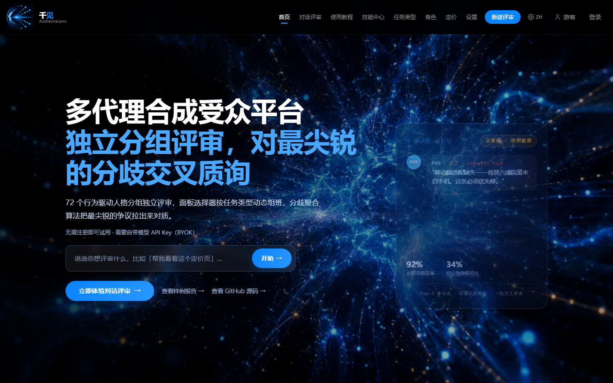
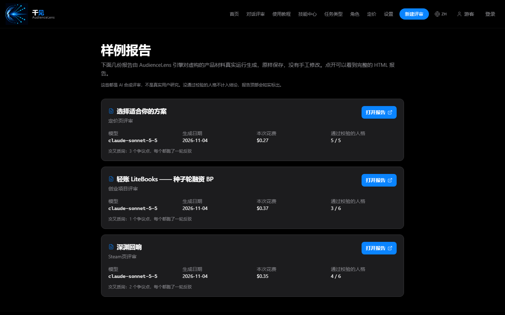
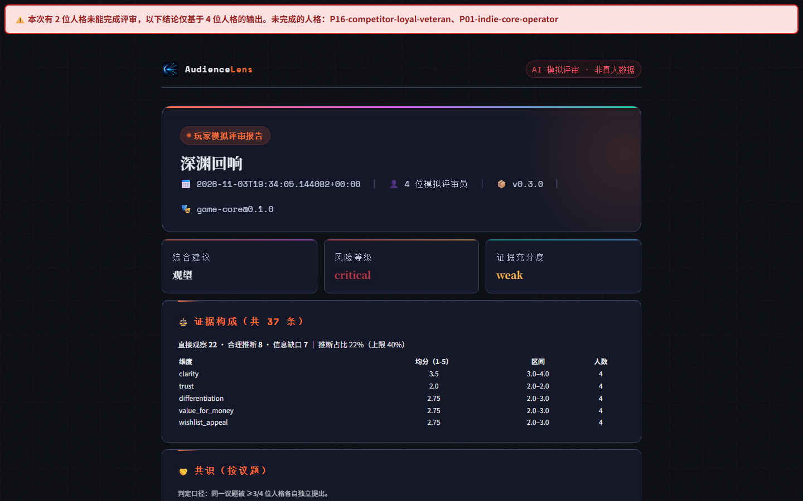
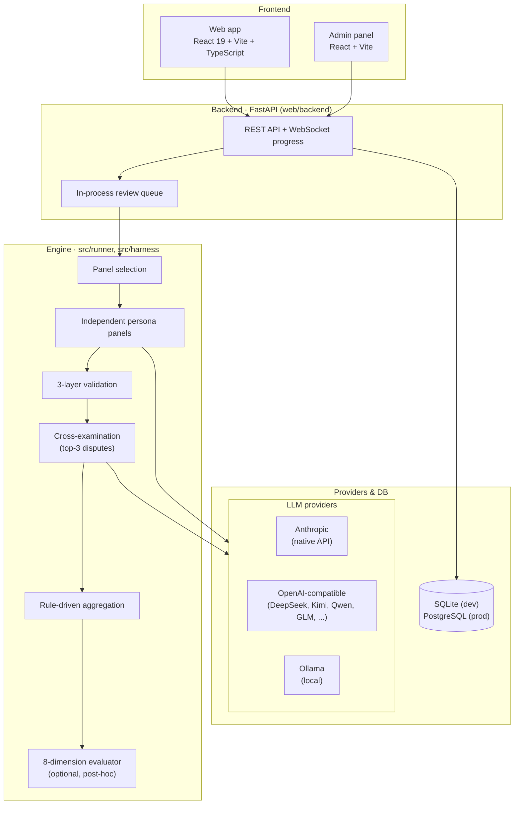

<div align="center">

# AudienceLens

**一组互不通气的 AI 人格独立评审你的产品，再把分歧最大的几处拉出来对质——每条依据都标明证据等级。**

[](https://github.com/jedi-ling/audiencelens/actions/workflows/ci.yml)
[](LICENSE)

[English](README.md) · 中文 · [日本語](README_ja.md)

</div>

- **是什么**：多代理「合成受众评审」系统——Python 引擎 + FastAPI/React Web 应用 + CLI + MCP 服务。输入 Steam 商店页、定价页、路演 BP 或游戏概念，输出结构化的风险、分歧与修改建议。
- **给谁用**：在花钱做真人用户研究之前，想先低成本快速初筛的独立开发者和小型产品团队。
- **有什么不同**：人格先各自独立评审（避免从众）；只对分歧最大的 Top-3 争议点做对质；改票由代码判定而不是让 LLM 当裁判；每条证据标注 `direct` / `inferred` / `gap`，推断占比硬上限 40%。

> **AudienceLens 不能替代真实用户研究。** 输出是合成的，**目前没有经过验证的准确率数据**（见下方「验证状态」）。

## 截图





## 样例报告

对虚构产品材料的真实引擎运行结果，原样保存、没有手工修改（`examples/reports/`，也可以在应用的 `/samples` 页浏览）。
standard 档，模型 `claude-sonnet-5-5`，2026-11-04，成本取自应用自己的计费。先跑人格评审，再用语义去重在同一批通过校验的人格输出上续跑交叉质询（`runner.cli.run_panel_from_outputs`）；`meta.json` 记录两步的出处，`persona_outputs.json` 存了续跑的输入，交叉质询这一步可以从仓库复现。

| 报告 | 输入 | 成本 | 通过校验的人格 | 交叉质询 |
|---|---|---|---|---|
| [Steam 商店页 — 深渊回响](examples/reports/steam-page-abyss-echo/report.md) | `test-materials/03_steam商店页_深渊回响.md` | $0.35 | 6 位中 4 位 | 2 个争议点，各一轮反驳 |
| [SaaS 定价页 — 云笔记订阅](examples/reports/saas-pricing-cloud-notes/report.md) | `test-materials/04_定价页_云笔记订阅.md` | $0.27 | 5 位全部 | 3 个争议点，各一轮反驳 |
| [创业 BP — 轻账 LiteBooks](examples/reports/startup-pitch-cloud-accounting/report.md) | `test-materials/02_创业BP_云会计SaaS.pdf` | $0.37 | 6 位中 3 位 | 1 个争议点，一轮反驳 |

三份反驳都没有改票：置信度最大只变了 2 分，阈值是 15 分。部分人格没通过校验、交叉质询为什么需要语义去重，见 [docs/evaluation/](docs/evaluation/)。

## 架构

前端（React 19 + Vite）→ FastAPI 后端（REST + WebSocket 进度）→ 核心引擎（`src/runner/`：面板选择 → 独立人格评审 → 三层校验 → 交叉质询 → 规则聚合；`src/harness/`：可选的 8 维事后评分）→ LLM（Anthropic 原生 / 任意 OpenAI 兼容服务 / 本地 Ollama）；数据库开发用 SQLite、生产用 PostgreSQL。细节见 [docs/ARCHITECTURE.md](docs/ARCHITECTURE.md)。



规模：11 个人格 Pack 共 72 个人格，14 种任务类型。

## 一次评审怎么跑

1. **选面板**：`src/runner/panel_selector.py` 按任务类型选人，并保证有一个唱反调的人格。
2. **独立评审**：每个人格各自并行评审（`src/runner/cli.py` 的 `run_panel`），第 4 步之前互相看不到对方的输出和身份。
3. **三层校验**：`src/runner/validator.py` 依次检查 schema、角色一致性、证据落地；不合格的输出可按 `src/config/budget.yaml` 重试，仍不合格就不进报告。
4. **提取分歧**：`src/runner/cross_exam.py` 的 `extract_controversy_points` 先按相似度合并同一问题，再按人格间严重度的方差排序取前 3。大家意见一致的点不辩。
5. **对质（每个争议点一轮反驳）**：每个点上立场最对立的两个人格拿到对方的论点（只标 `A1` / `B1`）。`standard` 档一次仲裁式调用，`full` 档逐人格调用，`quick` 档不跑。
6. **代码判定改票**：`_decide_change` 只在立场文字真的变了**且** `|Δ置信度| ≥ θ` 时记一次改票，θ 是 `src/config/aggregation-rules.yaml` 里的 `confidence_change_threshold: 0.15`。模型自称"被说服了"不算数。
7. **证据等级**：每条依据标 `direct`（材料原文）/ `inferred`（推断）/ `gap`（信息缺口）；`src/runner/validator.py` 的 `MAX_INFERRED_RATIO = 0.4` 把推断占比卡在 40%。

只实现了一轮反驳；多轮辩论、提前终止、共识演化**尚未实现**。

## 三个关键设计取舍

1. **先独立、后对质**：避免锚定与从众；代价是没有自然形成的共识，成本随面板人数线性增长。
2. **改票由代码判定**：可复现、可审计，不再引入一个"LLM 裁判"；代价是 θ=0.15 是工程拍板、未经校准，θ 以下的细微改变会被丢弃（保留在 `suppressed_changes` 里可查）。
3. **证据分级 + 推断上限**：让读者知道哪些话有原文依据；代价是等级由模型自报，只有 `direct` 会对照原文核查，40% 上限也可能误伤合理输出。

## 隐私与伦理

- **每个访客独立的游客身份**：签名的 HttpOnly、SameSite=Lax cookie（生产环境带 Secure），对话 / 评审 / 项目 / 用量 / CDK 余额都按它隔离；登录后只认领当前游客自己的数据。隔离测试见 `web/backend/tests/test_guest_isolation.py`（22 条）。
- **人口学字段不进提示词**：只有白名单 `CORE_FIELDS` 会写进 prompt（`src/runner/persona_agent.py` 的 `_minify_persona`），年龄段、地区等字段到不了模型；输出侧由 `check_identity_behavior_decoupling` 检查身份化推理。
- **自带 Key 加密存储**：用 Fernet（`cryptography`）加密，密钥由 `AL_ENCRYPTION_KEY` 派生，与会话签名密钥分离（`web/backend/app/core/security.py`）。
- 每份报告都带「AI 合成评审，非真实用户研究」声明，见 [ETHICS.md](ETHICS.md)。

## 技术栈

Python 3.11 · FastAPI · SQLAlchemy · SQLite / PostgreSQL 16 · React 19 · TypeScript · Vite · Tailwind CSS 4 · Vitest · Docker Compose + Caddy · GitHub Actions。

## 快速开始

```bash
# CLI（Anthropic Key）
pip install -e .
export ANTHROPIC_API_KEY=...
audiencelens run synthetic-playtest steam_page_review examples/steam-page-sample/artifact.json
```

不设 `ANTHROPIC_API_KEY` 时 CLI 进入**模拟模式**：所有人格输出都是占位数据，没有任何评审价值。

```bash
# Web（本地，自带 Key）
cd web/backend && pip install -r requirements.txt && python run.py   # http://127.0.0.1:8001
cd web/frontend && npm install && npm run dev                          # 另开一个终端
```

默认 `AL_AUTH_ENABLED=false`（单机形态）。在「设置 → API Key」里填 Anthropic Key，或任意 OpenAI 兼容服务（DeepSeek、Kimi、通义千问、智谱 GLM……），也可以选 **Ollama** 预设（`http://localhost:11434/v1`）用本地模型。

交叉质询只对多个人格都提到的问题发起，换个说法的同一问题要靠中文 embedding 模型合并（Docker 镜像默认已装）。本地开发：

```bash
pip install torch --index-url https://download.pytorch.org/whl/cpu
pip install sentence-transformers   # 首次使用会下载 BAAI/bge-small-zh-v1.5（约 93 MB）
```

不装的话引擎退回字符串相似度，报告里会明确提示"语义去重未安装，交叉质询可能无法触发"。

> **SSRF 防护**：后端拒绝指向环回 / 私网地址的 `api_base`，只有单机形态（`AL_AUTH_ENABLED=false`）且非生产主机时才放行，所以本地 Ollama 只适合本机自用。

## 测试

```bash
python -m pytest tests/ -q
(cd web/backend && python -m pytest tests/ -q)
(cd web/frontend && npm run build)
(cd web/admin && npx vitest run)
```

当前结果与 CI 说明见 [README.md](README.md#tests)。

## 验证状态

**目前没有经过验证的准确率数据。** 计划中的方法论：[基线盲测协议](docs/benchmark-protocol.md)、[Steam 商店页试点手册](docs/pilot-playbook.md)、[产品验证指标](docs/product-validation.md)、[真人对照数据收集方案](docs/parity-data-collection-plan.md)。早期的「赛博拾荒者」演示案例因无法复现已撤回，原因见论文 [§4.5](docs/paper/arxiv-paper.md#45-on-the-absence-of-a-case-study)。

<!-- TODO(evaluation): 基线盲测在真实项目上跑完之后再补「评测结果」一节，在那之前不写任何数字。 -->

## 已知局限

- 合成人格 ≠ 真实用户；
- 结果继承底层模型的偏见，不同服务商差异明显；
- 成本随面板人数增长；
- 目前不提供平台 Key，只支持自带 Key（BYOK）；
- 部分人格输出会被校验拦下（把改写标成 direct、或提交残缺），一轮修复能救回不少，但不是全部；
- 只有一轮反驳，θ 未经校准。

## 开发说明

AudienceLens 由 Ling Yuanyi 借助 AI 辅助开发（Claude Code、Codex、Trae、Qoder、Kimi）完成；设计、代码审阅与验证由作者负责。

## 许可与作者

[MIT](LICENSE) © 2026 Ling Yuanyi · GitHub [@jedi-ling](https://github.com/jedi-ling)
